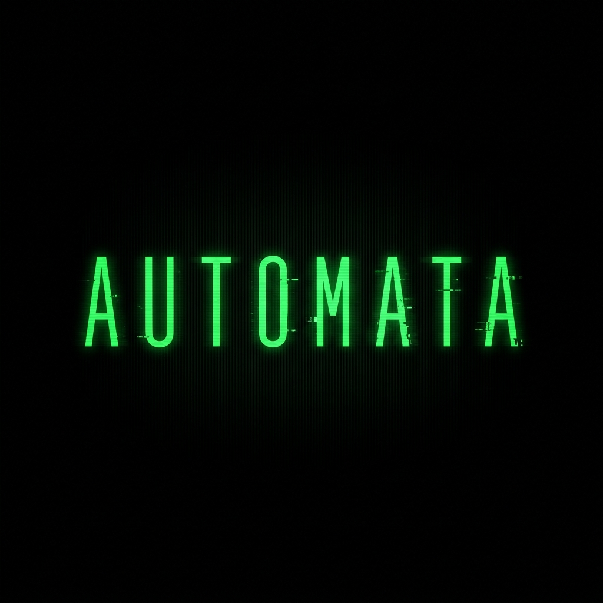

# Agency Agent Monorepo

This repo contains a small multi-agent system for brand research, storyboard planning, and social content generation. It is designed so a new machine can be prepared with one bootstrap script, then used through the Python CLIs, Makefile targets, PowerShell commands, skills, and MCP servers.

## What Is Inside
<div align="center">



# Automata

**A production-grade monorepo for building and running multi-agent AI systems.**

[](https://www.python.org/)
[](https://github.com/VRSEN/agency-swarm)
[](LICENSE)

*One prompt → complete deliverables. Research, slides, documents, images, videos — fully automated.*

</div>

---

## 🗺️ What is Automata?

**Automata** is a multi-agent AI system that automates end-to-end creative and research workflows. You describe what you need — a coordinated team of AI specialists delivers it.

It runs **8 specialized agents** under a single orchestrator. Each agent is an expert. They hand off tasks to each other automatically so nothing falls through the cracks.

---

## 🏗️ Structure

```
automata/
│
├── 🤖 agents/
│   ├── openedswarm_core/     ← Multi-agent swarm (8 agents, built on Agency Swarm)
│   └── automata_core/        ← Brand research & social automation agent
│
├── 🧩 packages/              ← Shared Python packages
│   ├── agency-common/        ← Shared utilities
│   ├── agency-research/      ← Research pipeline
│   ├── agency-storyboard/    ← Storyboard generation
│   ├── agency-content/       ← Content creation
│   └── openedswarm_core/     ← Swarm support package
│
├── 🎓 skills/                ← Modular agent skill packages
│   ├── agency-content/            ← Social copy, captions, weekly calendars
│   ├── agency-housekeeper/        ← Repo & vault cleanup decisions
│   ├── agency-ideation/           ← Strategy & campaign concept ideation
│   ├── agency-orchestrator/       ← Orchestration entry points
│   ├── agency-research/           ← Research workflows
│   ├── agency-storyboard/         ← Storyboarding
│   ├── frontend-design/           ← Frontend design guidance
│   ├── html-preview/              ← HTML preview rendering
│   ├── image-compositing-repair/  ← Deterministic image compositing & repair
│   ├── render-upscale-crop/       ← Exact 4K/8K upscaling & b-roll crops
│   ├── superdesign/               ← Design system generation
│   ├── visual-image/              ← AI image prompt references
│   ├── visual-video/              ← AI video prompt references
│   └── zen-magnific-automation/   ← Magnific Spaces browser automation
│
├── 🛠️ tools/
│   └── pdf_utils/
│
├── ⚙️ core/
│   ├── runner.py             ← Unified CLI entrypoint
│   └── session_logger.py     ← Centralized session logging
│
├── 💾 memory/                ← Agent memory & vector indexes (gitignored)
├── 📁 data/                  ← Brand assets & outputs (gitignored)
└── requirements.txt
```

---

## 🤖 Meet the Agents

| Agent | 🎯 Role | What it delivers |
|---|---|---|
| 🎛️ **Orchestrator** | Traffic controller | Routes every request to the right specialist. Never answers directly. |
| 🤝 **Virtual Assistant** | General-purpose executor | Email, calendar, Slack, GitHub, HubSpot + 10,000+ integrations via Composio |
| 🔬 **Deep Research** | Evidence-based researcher | Web research, competitive analysis, source-cited reports |
| 📊 **Data Analyst** | Quantitative analyst | Charts, statistical models, data visualizations |
| 📑 **Slides Agent** | Presentation engineer | Polished slide decks → exported `.pptx` |
| 📄 **Docs Agent** | Document engineer | Word docs, PDFs, Markdown — from outlines or raw content |
| 🎨 **Image Agent** | Visual creator | AI image generation & editing |
| 🎬 **Video Agent** | Video producer | AI video generation, editing, and assembly |

### ✨ Example prompts

```
"Create a complete investor pitch deck for our product"
→ Research gathers market data → Slides Agent builds the deck → Docs Agent writes the summary

"Research my top 5 competitors and write 3 SEO blog posts"
→ Deep Research runs analysis → Docs Agent writes and formats content

"Analyze this CSV and create a quarterly report with charts"
→ Data Analyst crunches numbers → Slides Agent presents the findings

"Generate a 30-second product launch video with branded graphics"
→ Image Agent creates visuals → Video Agent assembles and renders the clip
```

---

## 🚀 Quick Start

| Path | Purpose |
|------|---------|
| `packages/agency-common` | Shared brand loading, workspace paths, output writing, and models |
| `packages/agency-research` | Research agent CLI for competitor, trend, and sentiment analysis |
| `packages/agency-storyboard` | Storyboard agent CLI for scenes, visual direction, and generation prompts |
| `packages/agency-content` | Content agent CLI for captions, carousels, and weekly content |
| `skills/` | Agent instructions for MCP-capable coding assistants |
| `mcp/agents/` | Agent-scoped MCP manifests |
| `.mcp.json` | Aggregate MCP config for clients that use one project-level MCP file |
| `brands/` | Brand configuration files |
| `workspace/` | Temporary JSON, generated variants, and technical intermediates |

## Fresh Setup

These steps are for someone starting from a clean computer.

First install these on your computer:

- Git
- Python 3.11 or newer
- Node.js 20.19+, 22.12+, or 23+, which includes `npm` and `npx`
- `uv`

Then open only the section for your operating system.

<details open>
<summary><strong>Linux, macOS, or WSL</strong></summary>

### Linux/macOS/WSL Setup

Install `uv`:
- **Python 3.10+**
- At least one AI provider API key (see [API Keys](#-api-keys) below)

---

**1. Clone the repo**
```bash
curl -LsSf https://astral.sh/uv/install.sh | sh
```

Clone the repo:

```bash
git clone <this-repo-url>
cd automata
```

Run bootstrap:

```bash
bash scripts/bootstrap.sh
```

If Playwright browser installation fails on a minimal server:

```bash
bash scripts/bootstrap.sh --skip-playwright-browser
```

Copy the API key template:

```bash
cp env.example .env
```

Add keys to `~/.bashrc`, `~/.zshrc`, or your shell profile:

```bash
export FIRECRAWL_API_KEY=your_firecrawl_key_here
export APIFY_API_TOKEN=your_apify_token_here
```

Reload your shell:

```bash
source ~/.bashrc
```

Use `source ~/.zshrc` if you use Zsh.

Activate Python:

```bash
source .venv/bin/activate
```

You can skip activation when using `make` because the Makefile points to `.venv` directly.

</details>

<details>
<summary><strong>Windows PowerShell</strong></summary>

### Windows PowerShell Setup

Install `uv`:

```powershell
powershell -ExecutionPolicy ByPass -c "irm https://astral.sh/uv/install.ps1 | iex"
```

Close and reopen PowerShell.

Clone the repo:

```powershell
git clone <this-repo-url>
cd automata
```

Run bootstrap:

```powershell
powershell -ExecutionPolicy Bypass -File scripts/bootstrap.ps1
```

If Playwright browser installation fails:

```powershell
powershell -ExecutionPolicy Bypass -File scripts/bootstrap.ps1 -SkipPlaywrightBrowser
```

Copy the API key template:

```powershell
Copy-Item env.example .env
```

Set API keys:

```powershell
[Environment]::SetEnvironmentVariable("FIRECRAWL_API_KEY", "your_firecrawl_key_here", "User")
[Environment]::SetEnvironmentVariable("APIFY_API_TOKEN", "your_apify_token_here", "User")
```

Close and reopen PowerShell.

Activate Python:

```powershell
.\.venv\Scripts\Activate.ps1
```

You can skip activation when using `scripts/run-agent.ps1` because it points to `.venv` directly.

</details>

<details>
<summary><strong>Windows Command Prompt</strong></summary>

### Windows Command Prompt Setup

PowerShell is still recommended for Windows because API key setup is clearer. If you use Command Prompt, run:

```cmd
scripts\bootstrap.cmd
```

Activate Python:

```cmd
.venv\Scripts\activate.bat
```

For daily agent commands on Windows, use PowerShell:

```powershell
.\scripts\run-agent.ps1 dry-run -Brand example-brand
```

</details>

The bootstrap script checks Python, Node, npm, npx, and `uv`; creates `.venv`; installs the agency packages; validates MCP configs; verifies pinned npm MCP packages; installs Playwright Chromium; and reports missing API keys.

## Session Logging

Claude Code and Codex sessions can be logged into the Obsidian vault configured by `OBSIDIAN_VAULT_PATH`.

```bash
python3 scripts/log_session_to_vault.py --codex-current --commit-vault --commit-reason "user requested session log"
```

Session transcripts (both Claude Code and Codex) are written to `Agent_Sessions/` in the vault. This directory is excluded from the vector index so session noise does not pollute second-brain searches. Structured run summaries are written instead to `Brands/<slug>/Agent_Runs/` and are indexed.

## MCP Servers

The project-level MCP config [.mcp.json](.mcp.json) carries the shared servers (`figma`, `playwright`, `blender`, `higgsfield`). Agent-specific MCP manifests live under `mcp/agents/`; use those manifests to register only the servers needed for the current workflow. `perplexity`, `freepik-fastmcp`, and `capsulehub` were removed as redundant: Perplexity overlapped Firecrawl search and the Deep Research agent’s web search, Freepik asset/image generation overlapped Higgsfield, Magnific, and the Image Agent, and the CapsuleHub bridge was never registered in the agent manifests (manual-only) and saw no use.

| Server | Version | Agent | Needs Key | Purpose |
|--------|---------|-------|-----------|---------|
| `blender` | via `uvx blender-mcp` | Storyboard/3D | No (external Blender + addon) | Blender scene creation and inspection |
| `higgsfield` | remote `https://mcp.higgsfield.ai/mcp` | Storyboard/content | Higgsfield OAuth | Image (up to 4K) and short video generation, character training, background removal |
| `magnific` | remote `https://mcp.magnific.com` | Storyboard/content | Magnific OAuth | Magnific upscaling, image/video/audio/3D generation, and creation history |
| `playwright` | `@playwright/mcp@0.0.73` | Research | No | Browser automation and page extraction |
| `firecrawl` | `firecrawl-mcp@3.14.1` | Research | `FIRECRAWL_API_KEY` | Search, scrape, crawl, and structured extraction |
| `chrome-devtools` | `chrome-devtools-mcp@0.23.0` | Research | No | Console, network, screenshot, and performance inspection |
| `notebooklm` | `@roomi-fields/notebooklm-mcp@1.5.9` | Research | Google login/session | NotebookLM source-grounded Q&A and notebook workflows |
| `apify` | `@apify/actors-mcp-server@0.9.20` | Research | `APIFY_API_TOKEN` | Apify Actor-backed scraping for social and web workflows |
| `figma` | local `http://127.0.0.1:3845/mcp` | Design | Figma desktop app running | Read/write Figma canvas context for the final-asset workflow |

### Different MCP Harnesses

Most MCP clients can use the manifests under `mcp/agents/` directly or with small changes. If your harness expects a different format, copy the relevant `command`, `args`, and `env` entries from the agent manifest into that client.

For Codex on this machine, you can register a server manually with:

Magnific is already project-scoped in `.codex/config.toml`. Authenticate it once with `codex mcp login magnific`; the browser OAuth flow uses your Magnific account and stores no API key in this repo.

<details open>
<summary><strong>Linux, macOS, or WSL</strong></summary>

```bash
codex mcp add firecrawl --env 'FIRECRAWL_API_KEY=${FIRECRAWL_API_KEY}' -- bash scripts/mcp-npx.sh -y firecrawl-mcp@3.14.1
```

</details>

<details>
<summary><strong>Windows PowerShell</strong></summary>

```powershell
codex mcp add firecrawl --env "FIRECRAWL_API_KEY=$env:FIRECRAWL_API_KEY" -- npx -y firecrawl-mcp@3.14.1
```

</details>

Repeat the same pattern for any server in `mcp/agents/research.json` or `mcp/agents/storyboard.json`.

## Using The Agents

Open the section for your operating system.

<details open>
<summary><strong>Linux, macOS, or WSL</strong></summary>

### Linux/macOS/WSL Agent Commands

Check install:

```bash
make status
```

Validate a brand without API calls:

```bash
make dry-run BRAND=example-brand
```

Run research:

```bash
make research BRAND=example-brand
```

Run research with bounded parallel workers:

```bash
make research BRAND=example-brand PARALLEL=1 MAX_WORKERS=4
```

Use browser-act stealth extraction for public Instagram research:

```bash
make research BRAND=example-brand SCRAPER=browser-act PLATFORMS=ig PARALLEL=1 MAX_WORKERS=4
```

Use browser-act with a logged-in persistent session:

```bash
make research BRAND=example-brand SCRAPER=browser-act PLATFORMS=ig BROWSER_ACT_MODE=session BROWSER_ACT_SESSION_NAME=instagram-main
```

On Windows, create or refresh that logged-in browser-act session first:

```powershell
.\scripts\open-instagram-session.ps1 -Mode browser-act -BrowserActSessionName instagram-main -WaitForEnter
```

Use Playwright with a manually logged-in Instagram session:

```bash
make research BRAND=example-brand SCRAPER=playwright PLATFORMS=ig INSTAGRAM_LOGIN_MODE=manual
```

For CDP-based Instagram checks on Windows, open a persistent Chrome profile once, log into Instagram, and leave the browser open while research runs:

```powershell
.\scripts\open-instagram-session.ps1 -Mode cdp -CdpPort 9224 -WaitForEnter
.\scripts\run-agent.ps1 research -Brand example-brand -Scraper cdp -Platforms ig
```

Run storyboard:

```bash
make storyboard BRAND=example-brand TYPE=carousel TOPIC="5 tips for entrepreneurs"
```

Run content:

```bash
make content BRAND=example-brand TYPE=carousel TOPIC="5 tips for entrepreneurs"
```

Run the full pipeline:

```bash
make pipeline BRAND=example-brand TYPE=carousel TOPIC="5 tips for entrepreneurs"
```

</details>

<details>
<summary><strong>Windows PowerShell</strong></summary>

### Windows PowerShell Agent Commands

Check install:

```powershell
.\scripts\run-agent.ps1 status
```

Validate a brand without API calls:

```powershell
.\scripts\run-agent.ps1 dry-run -Brand example-brand
```

Run research:

```powershell
.\scripts\run-agent.ps1 research -Brand example-brand
```

Run research with bounded parallel workers:

```powershell
.\scripts\run-agent.ps1 research -Brand example-brand -Parallel -MaxWorkers 4
```

Use browser-act stealth extraction for public Instagram research:

```powershell
.\scripts\run-agent.ps1 research -Brand example-brand -Scraper browser-act -Platforms ig -Parallel -MaxWorkers 4
```

Use browser-act with a logged-in persistent session:

```powershell
.\scripts\run-agent.ps1 research -Brand example-brand -Scraper browser-act -Platforms ig -BrowserActMode session -BrowserActSessionName instagram-main
```

Create or refresh that browser-act login session first:

```powershell
.\scripts\open-instagram-session.ps1 -Mode browser-act -BrowserActSessionName instagram-main -WaitForEnter
```

Use Playwright with a manually logged-in Instagram session:

```powershell
.\scripts\run-agent.ps1 research -Brand example-brand -Scraper playwright -Platforms ig -InstagramLoginMode manual
```

Use CDP with a persistent Chrome profile:

```powershell
.\scripts\open-instagram-session.ps1 -Mode cdp -CdpPort 9224 -WaitForEnter
.\scripts\run-agent.ps1 research -Brand example-brand -Scraper cdp -Platforms ig
```

Run storyboard:

```powershell
.\scripts\run-agent.ps1 storyboard -Brand example-brand -Type carousel -Topic "5 tips for entrepreneurs"
```

Run content:

```powershell
.\scripts\run-agent.ps1 content -Brand example-brand -Type carousel -Topic "5 tips for entrepreneurs"
```

Run the full pipeline:

```powershell
.\scripts\run-agent.ps1 pipeline -Brand example-brand -Type carousel -Topic "5 tips for entrepreneurs"
```

</details>

Human-readable Markdown is written to the Obsidian vault as a draft:

```text
$OBSIDIAN_VAULT_PATH/Brands/<brand-slug>/Drafts/Research/
$OBSIDIAN_VAULT_PATH/Brands/<brand-slug>/Drafts/Storyboards/
$OBSIDIAN_VAULT_PATH/Brands/<brand-slug>/Drafts/Content/
```

Machine-readable JSON and disposable media intermediates remain under `workspace/`.
Pass `--commit-vault --commit-reason "..."` to write the note as final and update
the brand's distilled Memory.

The PowerShell wrapper accepts the equivalent `-CommitVault -CommitReason "..."` flags.

## Adding A New Brand

<details open>
<summary><strong>Linux, macOS, or WSL</strong></summary>

Copy the template:

```bash
cp brands/_template.yaml brands/my-brand.yaml
```

Edit `brands/my-brand.yaml`, then run:

```bash
make dry-run BRAND=my-brand
```

</details>

<details>
<summary><strong>Windows PowerShell</strong></summary>

Copy the template:

```powershell
Copy-Item brands/_template.yaml brands/my-brand.yaml
```

Edit `brands/my-brand.yaml`, then run:

```powershell
.\scripts\run-agent.ps1 dry-run -Brand my-brand
```

</details>

## Dev Containers

This repo includes [.devcontainer/devcontainer.json](.devcontainer/devcontainer.json) for VS Code Dev Containers or compatible tools. It installs Python and Node, installs `uv`, and runs:

```bash
bash scripts/bootstrap.sh --skip-playwright-browser
```

You still need to provide your own API keys inside the container.

## Common Problems

### `uv: command not found`

Install `uv`, then reopen your terminal:

<details open>
<summary><strong>Linux, macOS, or WSL</strong></summary>

```bash
curl -LsSf https://astral.sh/uv/install.sh | sh
```

</details>

<details>
<summary><strong>Windows PowerShell</strong></summary>

```powershell
powershell -ExecutionPolicy ByPass -c "irm https://astral.sh/uv/install.ps1 | iex"
```

</details>

### `npx: command not found`

Install Node.js 20.19+, 22.12+, or 23+ from `https://nodejs.org/`, then reopen your terminal.

### MCP Server Starts But Tool Fails With Auth Error

The API key is missing or not loaded into the environment. Check with:

<details open>
<summary><strong>Linux, macOS, or WSL</strong></summary>

```bash
echo "$FIRECRAWL_API_KEY"
echo "$APIFY_API_TOKEN"
```

</details>

<details>
<summary><strong>Windows PowerShell</strong></summary>

```powershell
echo $env:FIRECRAWL_API_KEY
echo $env:APIFY_API_TOKEN
```

</details>

### Playwright Cannot Open A Browser

Install Chromium:

<details open>
<summary><strong>Linux, macOS, WSL, or Windows PowerShell</strong></summary>

```bash
npx -y playwright@1.56.1 install chromium
```

</details>

On Linux servers, you may also need OS browser dependencies. Playwright will print the exact command for your distribution.

### Blender MCP Does Not Work

Blender MCP needs Blender running with the MCP addon enabled. The repo config only defines how the MCP server starts; it does not install Blender itself.

### A Different Harness Does Not Read `.mcp.json`

Use `mcp/agents/*.json` as a copy source. The important pieces are the server name, `command`, `args`, and `env`. Keep real API keys out of committed files.

## Maintenance

Pinned npm MCP versions are intentional. To update them later:

```bash
npm view @playwright/mcp version
npm view firecrawl-mcp version
npm view chrome-devtools-mcp version
npm view @apify/actors-mcp-server version
```

Then update `mcp/agents/*.json` and this README together.
git clone https://github.com/Gyanweshi/automata.git
cd automata
```

**2. Create and activate a virtual environment**
```bash
python -m venv .venv

# Windows
.venv\Scripts\activate

# macOS/Linux
source .venv/bin/activate
```

**3. Install dependencies**
```bash
# Recommended (reproducible)
uv sync --locked

# Compatibility fallback
pip install -r requirements.txt
```

**4. Configure API keys**
```bash
cp agents/openedswarm_core/.env.example agents/openedswarm_core/.env
# Edit .env and add your keys
```

**5. Run**
```bash
# Interactive multi-agent swarm
python core/runner.py --agent openedswarm

# Brand research agent
python core/runner.py --agent automata --brand "YourBrand" --action research

# API server (localhost:8080)
python agents/openedswarm_core/server.py
```

---

### Docker

```bash
cp agents/openedswarm_core/.env.example agents/openedswarm_core/.env
cd agents/openedswarm_core
docker-compose up --build
```

---

## 🔑 API Keys

| Key | Required | What it unlocks |
|---|---|---|
| `OPENAI_API_KEY` | ✅ Pick one | GPT models + Sora video |
| `ANTHROPIC_API_KEY` | ✅ Pick one | Claude models |
| `GOOGLE_API_KEY` | ⚡ Optional | Gemini image + Veo video |
| `FAL_KEY` | ⚡ Optional | Advanced video editing |
| `SEARCH_API_KEY` | ⚡ Optional | Web search for Deep Research |
| `COMPOSIO_API_KEY` | ⚡ Optional | 10,000+ integrations (Gmail, Slack, HubSpot…) |
| `PEXELS_API_KEY` | ⚡ Optional | Stock photos for Slides Agent |
| `PIXABAY_API_KEY` | ⚡ Optional | Stock photos for Slides Agent |
| `UNSPLASH_ACCESS_KEY` | ⚡ Optional | Stock photos for Slides Agent |

> **💡 Tip:** Tools degrade gracefully — the agent tells you exactly what key to add if a feature isn't available.

---

## 🧩 Packages

Shared installable Python packages, auto-installed via `requirements.txt`:

| Package | Purpose |
|---|---|
| `agency-common` | Shared utilities, file I/O, logging |
| `agency-research` | Web research and source synthesis pipeline |
| `agency-storyboard` | Storyboard & scene composition generation |
| `agency-content` | Content formatting and copy generation |

---

## 🎓 Skills

Modular capability packages loaded by agents on demand:

- `agency-research/` — Research workflows
- `agency-storyboard/` — Visual storyboarding
- `agency-content/` — Content generation pipelines
- `agency-orchestrator/` — Orchestration logic
- `agency-housekeeper/` — Repo & vault cleanup decisions and the retention watchdog
- `agency-ideation/` — Strategy and campaign concept ideation frameworks
- `superdesign/` — Design system generation
- `frontend-design/` — Frontend design guidance
- `html-preview/` — HTML preview rendering
- `visual-image/` — Image creation workflows
- `visual-video/` — Video production workflows
- `image-compositing-repair/` — Deterministic masks, composites, and regional image repair
- `render-upscale-crop/` — Exact 4K/8K Lanczos upscaling and b-roll crops
- `zen-magnific-automation/` — Recoverable Zen/Selenium automation for Magnific Spaces

Canonical skill packages live in `skills/`. Codex discovers project registrations
from `.agents/skills/`; Claude Code discovers them from `.claude/skills/`.

Creative brainstorming is available through `skills/agency-ideation/SKILL.md`, routed
by `AGENTS.md` and the orchestrator, storyboard, and content skills. Ask the assistant
`/agency ideate <brand-slug> "<brief>"`. The runtime uses the compact,
agency-authored `references/agency-bank.json` with 23 stable `es-*` IDs, a closed tag
vocabulary, six families, explicit platform/campaign/execution altitude, and near-twin pairing rules. The former authenticated Deck
index has been retired; normal ideation does not require Deck login or scraping. The
15-entry historical secondary-source pilot
remains separate and can be queried with `--historical`.

The integrated framework bank is `skills/agency-ideation/references/frameworks.json`.
It contains nine public methods from IDEO.org, Strategyzer, Blue Ocean Strategy, and
the Ehrenberg-Bass Institute, selected for audience insight, memory, problem framing,
proposition, differentiation, and testing. Retrieve by stage with
`.\.venv\Scripts\python.exe skills/agency-ideation/scripts/select_tools.py --frameworks --stage insight`.
The bank separates evidence, assumptions, and proposed offer changes; it does not
replace research or validate an idea by itself.
Platform- and campaign-altitude routes also receive a campaign-architecture pass for
flighting, channel roles, message hierarchy, and distribution assumptions.

Inspect the bank with
`.\.venv\Scripts\python.exe skills/agency-ideation/scripts/select_tools.py --list`
or inspect the vocabulary with `--list-tags`, then retrieve entries with
`--tag community --limit 5`. On Linux/macOS use `.venv/bin/python`.
This is an agent-led ideation and concept-handoff workflow; the standalone Python
`pipeline` command is unchanged and does not generate or ingest concept handoffs.
The intended agent order is `research -> evidence readiness -> ideation -> selected
concept -> storyboard -> content`. Research must surface missing, stale, irrelevant,
or unreliable inputs before downstream execution; storyboard is not a strategy-gap
resolver.

---

## ⚙️ Runner

`core/runner.py` is the single CLI entrypoint for all agents:

```bash
# Run the multi-agent swarm
python core/runner.py --agent openedswarm

# Run the brand research agent
python core/runner.py --agent automata --brand "Nike" --action research
```

All sessions are automatically logged via `core/session_logger.py`.

---

## 📁 Data & Outputs

> ⚠️ `data/` and `workspace/` are **gitignored** — temporary machine data and intermediates live only locally. Human-readable draft and final notes live in the vault.

| Folder | Contents |
|---|---|
| `data/outputs/` | Generated files (slides, docs, reports, videos) |
| `data/assets/brands/` | Brand asset libraries |
| `workspace/` | Temporary JSON, browser artifacts, generated variants, and agent working directories |
| `memory/` | Local vector DB and agent memory state |

---

## 🤝 External Integrations (via Composio)

With `COMPOSIO_API_KEY`, agents unlock **10,000+ tools**:

| Category | Integrations |
|---|---|
| 📧 Email | Gmail, Outlook |
| 📅 Calendar | Google Calendar, Calendly |
| 💬 Messaging | Slack, WhatsApp, Telegram, Discord |
| 📝 Docs | Google Docs, Notion, Airtable |
| 🗂️ Storage | Google Drive, Dropbox |
| 📋 PM | Jira, Asana, Trello, ClickUp, Monday |
| 📈 CRM | HubSpot, Salesforce, Pipedrive |
| 🛒 E-Commerce | Shopify |
| 🎨 Design | Figma, Canva, Miro |
| 💻 Dev | GitHub |

---

## 🧑‍💻 For Developers

**Key files:**

| File | Purpose |
|---|---|
| `agents/openedswarm_core/swarm.py` | Defines the swarm: all agents + communication flows |
| `agents/openedswarm_core/shared_instructions.md` | System prompt shared by every agent |
| `agents/openedswarm_core/.env.example` | All configurable environment variables |
| `core/runner.py` | Unified CLI runner |
| `requirements.txt` | All Python dependencies |

**Adding a new agent:**
1. Create `agents/openedswarm_core/<agent_name>/` with `<agent_name>.py` + `instructions.md` + `tools/`
2. Import and register it in `swarm.py`
3. Update `shared_instructions.md` with the agent's role

---

## 📄 License

MIT — see [LICENSE](agents/openedswarm_core/LICENSE).

---

<div align="center">

*If this helps you ship faster, drop a ⭐*

</div>
