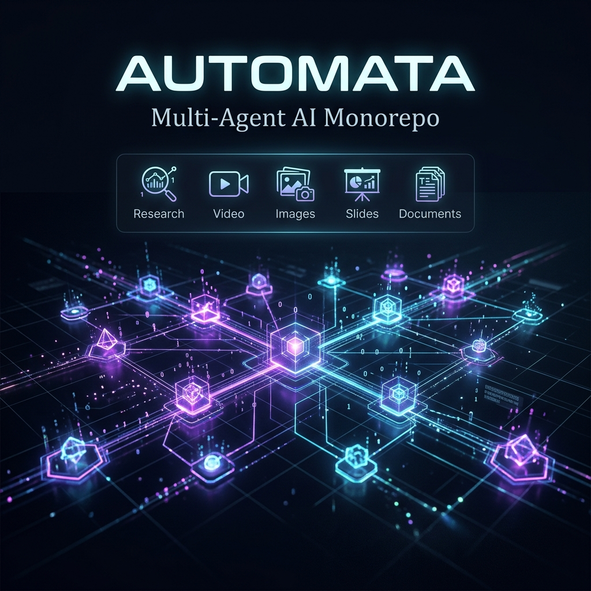

<div align="center">



# Automata

**A production-grade monorepo for building and running multi-agent AI systems.**

[](https://www.python.org/)
[](https://github.com/VRSEN/agency-swarm)
[](LICENSE)

*One prompt → complete deliverables. Research, slides, documents, images, videos — fully automated.*

</div>

---

## 🗺️ What is Automata?

**Automata** is a multi-agent AI system that automates end-to-end creative and research workflows. You describe what you need — a coordinated team of AI specialists delivers it.

It runs **8 specialized agents** under a single orchestrator. Each agent is an expert. They hand off tasks to each other automatically so nothing falls through the cracks.

---

## 🏗️ Structure

```
automata/
│
├── 🤖 agents/
│   ├── swarm/                ← Multi-agent swarm (8 agents)
│   └── automata_core/        ← Brand research & social automation agent
│
├── 🧩 packages/              ← Shared Python packages
│   ├── agency-common/        ← Shared utilities
│   ├── agency-research/      ← Research pipeline
│   ├── agency-storyboard/    ← Storyboard generation
│   ├── agency-content/       ← Content creation
│   └── freepik-fastmcp/      ← Freepik MCP integration
│
├── 🎓 skills/                ← Modular agent skill packages
│   ├── agency-content/
│   ├── agency-orchestrator/
│   ├── agency-research/
│   ├── agency-storyboard/
│   ├── superdesign/
│   ├── visual-image/
│   └── visual-video/
│
├── 🛠️ tools/
│   └── pdf_utils/
│
├── ⚙️ core/
│   ├── runner.py             ← Unified CLI entrypoint
│   └── session_logger.py     ← Centralized session logging
│
├── 💾 memory/                ← Agent memory & vector indexes (gitignored)
├── 📁 data/                  ← Brand assets & outputs (gitignored)
└── requirements.txt
```

---

## 🤖 Meet the Agents

| Agent | 🎯 Role | What it delivers |
|---|---|---|
| 🎛️ **Orchestrator** | Traffic controller | Routes every request to the right specialist. Never answers directly. |
| 🤝 **Virtual Assistant** | General-purpose executor | Email, calendar, Slack, GitHub, HubSpot + 10,000+ integrations via Composio |
| 🔬 **Deep Research** | Evidence-based researcher | Web research, competitive analysis, source-cited reports |
| 📊 **Data Analyst** | Quantitative analyst | Charts, statistical models, data visualizations |
| 📑 **Slides Agent** | Presentation engineer | Polished slide decks → exported `.pptx` |
| 📄 **Docs Agent** | Document engineer | Word docs, PDFs, Markdown — from outlines or raw content |
| 🎨 **Image Agent** | Visual creator | AI image generation & editing |
| 🎬 **Video Agent** | Video producer | AI video generation, editing, and assembly |

### ✨ Example prompts

```
"Create a complete investor pitch deck for our product"
→ Research gathers market data → Slides Agent builds the deck → Docs Agent writes the summary

"Research my top 5 competitors and write 3 SEO blog posts"
→ Deep Research runs analysis → Docs Agent writes and formats content

"Analyze this CSV and create a quarterly report with charts"
→ Data Analyst crunches numbers → Slides Agent presents the findings

"Generate a 30-second product launch video with branded graphics"
→ Image Agent creates visuals → Video Agent assembles and renders the clip
```

---

## 🚀 Quick Start

### Prerequisites

- **Python 3.10+**
- At least one AI provider API key (see [API Keys](#-api-keys) below)

---

**1. Clone the repo**
```bash
git clone https://github.com/Gyanweshi/automata.git
cd automata
```

**2. Create and activate a virtual environment**
```bash
python -m venv .venv

# Windows
.venv\Scripts\activate

# macOS/Linux
source .venv/bin/activate
```

**3. Install dependencies**
```bash
pip install -r requirements.txt
```

**4. Configure API keys**
```bash
cp agents/swarm/.env.example agents/swarm/.env
# Edit .env and add your keys
```

**5. Run**
```bash
# Interactive multi-agent swarm
python agents/swarm/run.py

# Brand research agent
python core/runner.py --agent automata --brand "YourBrand" --action research

# API server (localhost:8080)
python agents/swarm/server.py
```

---

### Docker

```bash
cp agents/swarm/.env.example agents/swarm/.env
docker-compose up --build
```

---

## 🔑 API Keys

| Key | Required | What it unlocks |
|---|---|---|
| `OPENAI_API_KEY` | ✅ Pick one | GPT models + Sora video |
| `ANTHROPIC_API_KEY` | ✅ Pick one | Claude models |
| `GOOGLE_API_KEY` | ⚡ Optional | Gemini image + Veo video |
| `FAL_KEY` | ⚡ Optional | Advanced video editing |
| `SEARCH_API_KEY` | ⚡ Optional | Web search for Deep Research |
| `COMPOSIO_API_KEY` | ⚡ Optional | 10,000+ integrations (Gmail, Slack, HubSpot…) |

> **💡 Tip:** Tools degrade gracefully — the agent tells you exactly what key to add if a feature isn't available.

---

## 🧩 Packages

Shared installable Python packages, auto-installed via `requirements.txt`:

| Package | Purpose |
|---|---|
| `agency-common` | Shared utilities, file I/O, logging |
| `agency-research` | Web research and source synthesis pipeline |
| `agency-storyboard` | Storyboard & scene composition generation |
| `agency-content` | Content formatting and copy generation |
| `freepik-fastmcp` | Freepik asset library MCP integration |

---

## 🎓 Skills

Modular capability packages loaded by agents on demand:

- `agency-research/` — Research workflows
- `agency-storyboard/` — Visual storyboarding
- `agency-content/` — Content generation pipelines
- `superdesign/` — Design system generation
- `visual-image/` — Image creation workflows
- `visual-video/` — Video production workflows
- `agency-orchestrator/` — Orchestration logic

---

## ⚙️ Runner

`core/runner.py` is the single CLI entrypoint for all agents:

```bash
# Run the multi-agent swarm
python core/runner.py --agent openedswarm

# Run the brand research agent
python core/runner.py --agent automata --brand "Nike" --action research
```

All sessions are automatically logged via `core/session_logger.py`.

---

## 📁 Data & Outputs

> ⚠️ `data/` and `workspace/` are **gitignored** — generated outputs live only locally.

| Folder | Contents |
|---|---|
| `data/outputs/` | Generated files (slides, docs, reports, videos) |
| `data/assets/brands/` | Brand asset libraries |
| `workspace/` | Temporary agent working directories |
| `memory/` | Local vector DB and agent memory state |

---

## 🤝 External Integrations (via Composio)

With `COMPOSIO_API_KEY`, agents unlock **10,000+ tools**:

| Category | Integrations |
|---|---|
| 📧 Email | Gmail, Outlook |
| 📅 Calendar | Google Calendar, Calendly |
| 💬 Messaging | Slack, WhatsApp, Telegram, Discord |
| 📝 Docs | Google Docs, Notion, Airtable |
| 🗂️ Storage | Google Drive, Dropbox |
| 📋 PM | Jira, Asana, Trello, ClickUp, Monday |
| 📈 CRM | HubSpot, Salesforce, Pipedrive |
| 🛒 E-Commerce | Shopify |
| 🎨 Design | Figma, Canva, Miro |
| 💻 Dev | GitHub |

---

## 🧑‍💻 For Developers

**Key files:**

| File | Purpose |
|---|---|
| `agents/swarm/swarm.py` | Defines the swarm: all agents + communication flows |
| `agents/swarm/shared_instructions.md` | System prompt shared by every agent |
| `agents/swarm/.env.example` | All configurable environment variables |
| `core/runner.py` | Unified CLI runner |
| `requirements.txt` | All Python dependencies |

**Adding a new agent:**
1. Create `agents/swarm/<agent_name>/` with `<agent_name>.py` + `instructions.md` + `tools/`
2. Import and register it in `swarm.py`
3. Update `shared_instructions.md` with the agent's role

---

## 📄 License

MIT — see [LICENSE](agents/swarm/LICENSE).

---

<div align="center">

*If this helps you ship faster, drop a ⭐*

</div>
