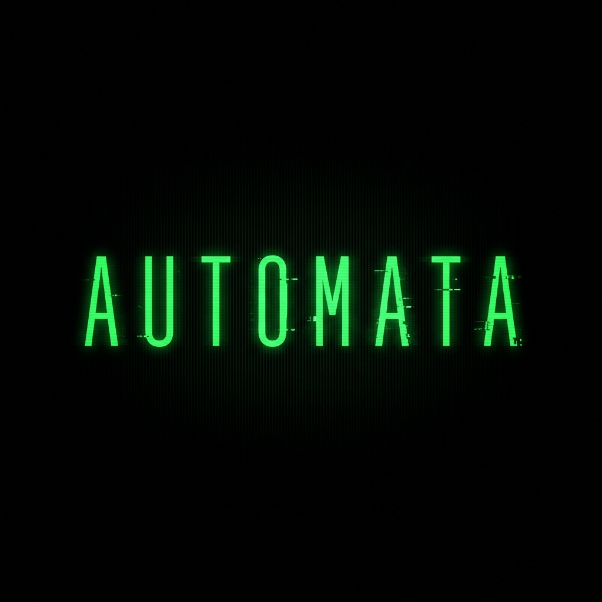

<div align="center">



# Automata

**A production-grade multi-agent AI system for brand research, visual storyboards, content generation, and autonomous task execution.**

[](https://www.python.org/)
[](https://github.com/VRSEN/agency-swarm)
[](https://modelcontextprotocol.io/)
[](LICENSE)

*One prompt → complete deliverables. Market research, pitch decks, copy, storyboards, and multi-platform automation.*

</div>

---

## 🗺️ What is Automata?

**Automata** unites two powerful agent paradigms in one clean monorepo:

1. **The Agency Pipeline**: A structured brand automation pipeline that takes a brand profile through competitive research, creative ideation, visual storyboarding, and platform-ready social content.
2. **OpenSwarm Specialists**: A swarm of 8 coordinated AI agents running under a single orchestrator. Agents autonomously delegate tasks to each other, execute code, generate documents, and access 10,000+ external tools.

---

## 🏗️ Repository Structure

```
automata/
│
├── 🤖 agents/
│   └── openedswarm_core/          ← 8-agent swarm built on Agency Swarm
│       ├── orchestrator/          ← Master router; delegates every incoming task
│       ├── deep_research/         ← Deep web research and source-cited reports
│       ├── data_analyst_agent/    ← Data science, statistics, and visualization
│       ├── docs_agent/            ← Polished documents (Word, PDF, Markdown)
│       ├── slides_agent/          ← Presentation slides exported to .pptx
│       ├── image_generation_agent/← AI image generation & editing
│       ├── video_generation_agent/← AI video generation & assembly
│       └── virtual_assistant/     ← 10,000+ external app actions via Composio
│
├── 🧩 packages/                   ← Installable core Python packages
│   ├── agency-common/             ← Shared models, workspace paths, and workflow discovery
│   ├── agency-research/           ← Research pipeline (scrapers, competitor analysis)
│   ├── agency-storyboard/         ← Storyboard & visual scene composition
│   └── agency-content/            ← Copywriting, carousels, and calendars
│
├── 🎓 skills/                     ← Modular agent skill packages
│   ├── agency-orchestrator/       ← Master skill & agent routing
│   ├── agency-research/           ← Deep competitor & audience research
│   ├── agency-ideation/           ← Sourced creative frameworks (IDEO, Strategyzer, Blue Ocean)
│   ├── agency-storyboard/         ← Scene planning & visual prompts
│   ├── agency-content/            ← Brand-aligned social copy & calendars
│   ├── agency-housekeeper/        ← Workspace & vault retention hygiene
│   └── [higgsfield, design...]    ← Dedicated image, video, and design skills
│
├── ⚙️ core/                       ← Unified CLI runner and session logging
├── 🔌 mcp/                        ← Agent-scoped Model Context Protocol manifests
├── 🏷️ brands/                     ← Brand configuration templates and profiles
└── 📁 workspace/                  ← Disposable run data and scratch files (gitignored)
```

---

## 🤖 Meet the Agents

| Agent | 🎯 Role | What It Delivers |
|---|---|---|
| 🎛️ **Orchestrator** | Traffic Controller | Dispatches requests to the right specialist. Never answers directly. |
| 🔬 **Deep Research** | Evidence Researcher | Competitor audits, market analysis, and source-cited briefings. |
| 📊 **Data Analyst** | Data Scientist | Number crunching, chart generation, and dataset statistics. |
| 📑 **Slides Agent** | Presentation Designer | Slide architecture and polished decks exported to `.pptx`. |
| 📄 **Docs Agent** | Document Engineer | Comprehensive reports, Word documents, PDFs, and Markdown. |
| 🎨 **Image Agent** | Visual Creator | Image generation, mockups, restyling, and visual assets. |
| 🎬 **Video Agent** | Video Producer | Script breakdown, scene generation, and video montage assembly. |
| 🤝 **Virtual Assistant** | Tool Executor | Email, Slack, GitHub, calendar, and 10,000+ Composio integrations. |

### Example Multi-Agent Flows

- **Investor Pitch Deck**: Deep Research gathers market stats → Slides Agent designs the deck → Docs Agent writes the executive summary.
- **Competitor Strategy**: Deep Research audits top competitors → Agency Ideation crafts differentiated positioning → Agency Content drafts launch campaigns.
- **Quarterly Business Review**: Data Analyst crunches financial CSVs → Slides Agent generates visualizations → Virtual Assistant shares the draft in Slack.

---

## 🚀 Quick Start

### New machine: one paste

Works on a machine with nothing installed, not even Python. Open a terminal, paste the block for your OS,
approve the GitHub login that opens in your browser, and wait (about 5–10 minutes, mostly downloads). Running it
again later is safe: it skips whatever is already there.

**Windows** (PowerShell; winget ships with Windows 10 and 11):
```powershell
foreach ($id in "Git.Git", "GitHub.cli", "astral-sh.uv") { winget install -e --id $id --accept-source-agreements --accept-package-agreements }
$env:Path = [Environment]::GetEnvironmentVariable("Path","Machine") + ";" + [Environment]::GetEnvironmentVariable("Path","User") + ";$env:LOCALAPPDATA\Microsoft\WinGet\Links"
gh auth status 2>$null; if ($LASTEXITCODE) { gh auth login --web --git-protocol https }; gh auth setup-git
if (-not (Test-Path automata)) { gh repo clone Gyanweshi/automata }; Set-Location automata
uv run --no-project --python 3.12 scripts\bootstrap.py --yes
```

**Linux** (Ubuntu, Mint, Debian; macOS: replace the first line with `xcode-select --install; brew install gh`):
```bash
sudo apt-get update && sudo apt-get install -y git curl gh
command -v uv >/dev/null || curl -LsSf https://astral.sh/uv/install.sh | sh; export PATH="$HOME/.local/bin:$PATH"
gh auth status >/dev/null 2>&1 || gh auth login --web --git-protocol https; gh auth setup-git
[ -d automata ] || gh repo clone Gyanweshi/automata; cd automata
uv run --no-project --python 3.12 scripts/bootstrap.py --yes
```

What happens: Git, the GitHub CLI and uv are installed; you log in to GitHub once in the browser (the repo is
private); the repo is cloned; then the setup script downloads Python 3.12 if the machine has none, installs
Node.js and every other missing tool, builds the environment from the lockfiles, installs the browsers, asks
once whether to register the nightly jobs, and finishes by checking every part of the setup with a
`PASS` / `WARN` / `FAIL` summary. A `WARN` is an optional tool, listed with the command that installs it.

Last step: copy `env.example` to `.env` and add your API keys.

### Machine already set up

```bash
git pull
python scripts/bootstrap.py          # repair / update after a pull (Windows: python scripts\bootstrap.py)
python scripts/doctor.py             # only check, changes nothing (or: make doctor)
```

<details>
<summary><strong>Docker & Dev Containers</strong></summary>

#### Using VS Code Dev Containers
Open this folder in VS Code with the **Dev Containers** extension installed. It will automatically load [.devcontainer/devcontainer.json](.devcontainer/devcontainer.json) and set up Python, Node.js, and dependencies.

#### Using Docker Compose directly
```bash
cp agents/openedswarm_core/.env.example agents/openedswarm_core/.env
cd agents/openedswarm_core
docker-compose up --build
```

</details>

### After setup

- **Optional tools** (ffmpeg, GIMP, Blender, raea, ImageMagick, ...) show as `warn` in `deps.py check`, each with
  its install command; `python scripts/deps.py install ID` installs one. The full list, what each is for, and
  how to update or fix it is in [docs/DEPENDENCIES.md](docs/DEPENDENCIES.md).
- **Nightly jobs:** `python scripts/schedule.py install vault-index` and `... install housekeeper` register them
  with this machine's scheduler (Task Scheduler on Windows, systemd/cron on Linux).
- **After `git pull`** on either machine, re-run the setup script if dependencies changed; it is quick when
  nothing is missing.

---

## ⚡ Running Automata

Automata supports two primary execution modes:

### Mode 1: The Agency Brand Pipeline

Run individual stages or execute the full end-to-end agency pipeline:

<details open>
<summary><strong>Linux / macOS / WSL</strong></summary>

```bash
# 1. Competitive & audience research
make research BRAND=example-brand

# 2. Visual storyboard creation
make storyboard BRAND=example-brand TYPE=carousel TOPIC="5 tips for entrepreneurs"

# 3. Copywriting & captions
make content BRAND=example-brand TYPE=carousel TOPIC="5 tips for entrepreneurs"

# 4. Full end-to-end pipeline (Research -> Storyboard -> Content)
make pipeline BRAND=example-brand TYPE=carousel TOPIC="5 tips for entrepreneurs"
```

**Advanced Research Options:**
```bash
# Bounded parallel workers
make research BRAND=example-brand PARALLEL=1 MAX_WORKERS=4

# Stealth Instagram scraper via browser-act
make research BRAND=example-brand SCRAPER=browser-act PLATFORMS=ig PARALLEL=1 MAX_WORKERS=4

# Authenticated persistent browser session
make research BRAND=example-brand SCRAPER=browser-act PLATFORMS=ig BROWSER_ACT_MODE=session BROWSER_ACT_SESSION_NAME=instagram-main
```

</details>

<details>
<summary><strong>Windows PowerShell</strong></summary>

```powershell
# 1. Competitive & audience research
py scripts\run-agent.py research --brand example-brand

# 2. Visual storyboard creation
py scripts\run-agent.py storyboard --brand example-brand --type carousel --topic "5 tips for entrepreneurs"

# 3. Copywriting & captions
py scripts\run-agent.py content --brand example-brand --type carousel --topic "5 tips for entrepreneurs"

# 4. Full end-to-end pipeline
py scripts\run-agent.py pipeline --brand example-brand --type carousel --topic "5 tips for entrepreneurs"
```

**Persistent Instagram Login Helper (Windows):**
```powershell
# Open persistent CDP Chrome profile for one-time login:
py scripts\open-instagram-session.py --cdp-port 9224 --wait

# Run CDP-backed research:
py scripts\run-agent.py research --brand example-brand --scraper cdp --platforms ig
```

</details>

---

### Mode 2: Interactive Swarm Specialists

Run the unified CLI runner to converse with the multi-agent swarm:

```bash
# Launch interactive terminal swarm session
python core/runner.py --agent openedswarm

# Launch brand research agent directly
python core/runner.py --agent automata --brand "example-brand" --action research

# Run the OpenSwarm REST API server (localhost:8080)
python agents/openedswarm_core/server.py
```

---

## 🎓 Skills & Workflow Discovery

Automata includes modular agent skills under `skills/`. Every agent checks available skills and specialist instructions **before planning or executing any task**.

### Discovery & Sync Tools
- `make list-workflows`: Lists all registered skills, specialist agent instruction paths, and routing policies.
- `make check-skills`: Verifies that skill shims are synchronized across Codex (`.agents/skills/`) and Claude Code (`.claude/skills/`).
- `make install-skills`: Generates or updates missing discovery shims for your local coding assistants.

### Available Skill Catalog
- **`agency-orchestrator`**: Master routing and brand execution coordinator.
- **`agency-research`**: Competitor analysis, audience sentiment, and platform trends.
- **`agency-ideation`**: Problem framing and campaign ideation using frameworks from IDEO, Strategyzer, and Blue Ocean Strategy.
- **`agency-storyboard`**: Visual scenes, shot lists, and image generation prompts.
- **`agency-content`**: Brand voice copywriting, captions, carousels, and calendars.
- **`agency-housekeeper`**: Retention policies and workspace/vault cleanup decisions.
- **`higgsfield-*` suite**: Image generation, product photoshoots, brand kits, and video explainers.
- **`frontend-design` & `superdesign`**: Token-driven slide design and UI architecture.
- **`html-preview`**: Headless Playwright screenshot verification of local HTML files.
- **`visual-image` & `visual-video`**: Curated prompt libraries for AI image/video models.
- **`image-gen`**: OpenAI GPT Image generation/edits and local animated-GIF assembly via portable Python CLIs.
- **`image-compositing-repair`**: Local, non-generative image editing (GIMP MCP or Python/OpenCV/Pillow) that preserves untouched pixels.
- **`previz-3d`**: Greybox 3D previz (camera moves, subject motion, keyframes) rendered locally with [raea](https://github.com/shinyobjectz/raea) before AI video generation. Install with `python scripts/deps.py install raea`.

---

## 🔌 Model Context Protocol (MCP)

Automata connects agents directly to external browsers, design tools, and AI generation backends via MCP:

| Server | Agent Scope | Required Auth | Purpose |
|---|---|---|---|
| `playwright` | Research | None | Headless browser automation and page scraping |
| `chrome-devtools` | Research | None | Console inspection, network monitoring, screenshots |
| `notebooklm` | Research | Google Login | Grounded Q&A against source documents |
| `apify` | Research | `APIFY_API_TOKEN` | Actor-backed social media extraction (Instagram, LinkedIn) |
| `figma` | Design | Figma Desktop | Canvas context inspection and vector delivery |
| `higgsfield` | Storyboard / Content | Higgsfield OAuth | Up to 4K image and video generation |
| `magnific` | Storyboard / Content | Magnific OAuth | AI upscaling, restyling, and generation history |
| `blender` | Storyboard / 3D | Blender + Addon | Programmatic 3D scene creation and rendering |
| `gimp` | Storyboard / Image editing | GIMP 3.2 + plugin (`python scripts/install-gimp-mcp.py`) | Local image editing: retouch, masks, layers, color, text, XCF export |

*Project-wide MCP configuration is managed in [.mcp.json](.mcp.json); agent-specific configurations live in `mcp/agents/`.*

---

## 🔑 API Keys Reference

| Key | Purpose | Required? |
|---|---|---|
| `OPENAI_API_KEY` | GPT models + Sora video | ✅ Yes (or Anthropic) |
| `ANTHROPIC_API_KEY` | Claude 3.5 / 3.7 models | ✅ Yes (or OpenAI) |
| `APIFY_API_TOKEN` | Social media scrapers | Recommended for social research |
| `GOOGLE_API_KEY` | Gemini and Veo models | Optional |
| `COMPOSIO_API_KEY` | 10,000+ app integrations (Slack, Gmail, HubSpot) | Optional (for Virtual Assistant) |
| `PEXELS_API_KEY` / `UNSPLASH_ACCESS_KEY` | Stock photography in presentations | Optional (for Slides Agent) |

> 💡 **Graceful Degradation**: Agents report missing API keys when an optional tool is called rather than failing to start.

---

## 📁 Storage & Obsidian Vault Integration

Automata keeps code and disposable runs clean by separating working files:

1. **Obsidian Vault (`$OBSIDIAN_VAULT_PATH`)**:
   - The permanent home for human-readable notes, research briefings, scripts, and content calendars.
   - Drafts are stored under `Brands/<slug>/Drafts/<type>/` (`status: draft`).
   - Approved final assets live under `Brands/<slug>/<type>/` (`status: final`).
   - Memory is recorded in `Brands/<slug>.md` (distilled to at most 10 key bullets).
2. **Local Workspace (`workspace/`)**:
   - Temporary intermediate JSON files, browser screenshots, and generated image variants remain strictly local and are **gitignored**.

---

## 🛠️ Adding a New Brand

To onboard a brand:

```bash
# 1. Copy the brand template
cp brands/_template.yaml brands/my-brand.yaml

# 2. Fill in voice, audience, competitors, and tone in brands/my-brand.yaml

# 3. Validate configuration without incurring API costs
make dry-run BRAND=my-brand
```

---

## ❓ Troubleshooting & FAQ

<details>
<summary><strong>Fresh machine troubleshooting</strong></summary>

- **Something is "not recognized" right after installing it:** the terminal still has the old PATH. Run the
  second line of the Windows block again (or open a new terminal), then re-run the last line.
- **`winget` is not recognized:** update "App Installer" from the Microsoft Store, then paste the block again.
- **`python` opens the Microsoft Store or is missing:** that's fine; the setup never needs a system Python
  (`uv run --python 3.12` brings its own). After setup, the repo's Python is `.venv\Scripts\python.exe`
  (Linux `.venv/bin/python`).
- **GitHub Desktop or VS Code cloned the repo but `git` is not recognized:** they bundle a private git;
  the paste block installs the real one.
- **A step failed:** fix what the summary says and run `python scripts/bootstrap.py` again; it picks up where
  things are missing. `docs/DEPENDENCIES.md` lists every tool, how to update it, and what to do when it breaks.
</details>

<details>
<summary><strong>Playwright cannot launch browser</strong></summary>

Re-run the setup script; it installs the Chromium build for both the Node and the Python Playwright (each
version needs its own). On Linux, if system libraries are missing, Playwright prints the exact `apt-get`
command required.
</details>

<details>
<summary><strong>MCP server returns authentication error</strong></summary>

Check that your environment variable is loaded in your current shell:
```bash
echo "$APIFY_API_TOKEN"
```
Ensure keys are exported in `.env` or your shell configuration (`~/.bashrc`, `~/.zshrc`).
</details>

---

## 📄 License

This project is licensed under the [MIT License](LICENSE).
